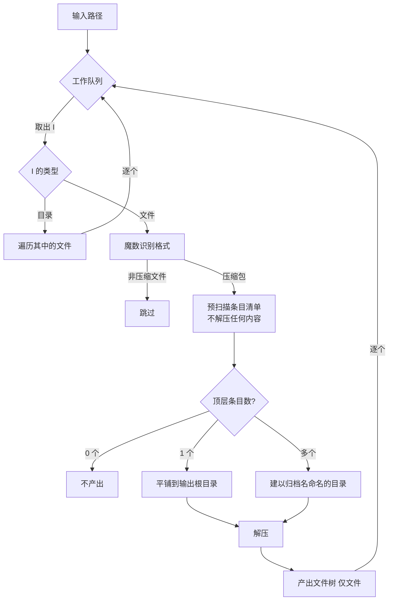
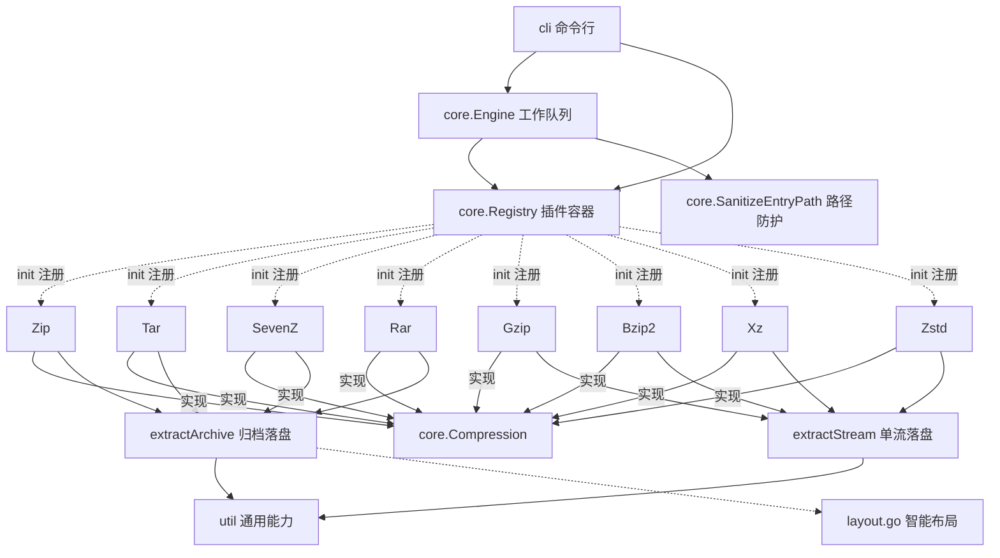

# 解压工具（Go 实现）

用 Go 重写的跨平台命令行解压工具，功能对标原版 `Decompression.exe`（Java Swing 版），
**不依赖 JRE，也不依赖任何原生动态库** —— 单个静态二进制，拷走即用。

## 特性

| 项目 | 说明 |
|---|---|
| 支持格式 | ZIP、TAR、GZIP、BZIP2、XZ、ZSTD、7Z、RAR（2.0/3.0/5.0） |
| 依赖 | 纯 Go，`CGO_ENABLED=0` 静态编译，跨平台零外部依赖 |
| RAR 支持 | 纯 Go 解码，支持加密、分卷、solid、Unicode 文件名 |
| 识别方式 | **魔数嗅探**，改扩展名的文件照样能识别 |
| 智能输出 | 解压前先扫描条目清单，顶层多条目时自动建目录，避免产物扁平释放 |
| 嵌套解压 | 解压产物自动重新入队，子压缩包被逐层解开 |
| 安全 | 修复了原版的 Zip Slip 路径穿越漏洞 |

## 快速开始

```bash
# 编译
make build          # 产物在 bin/decompress
make release        # 交叉编译各平台，产物在 dist/

# 使用
./bin/decompress archive.zip
./bin/decompress -o ./output -r ./downloads
./bin/decompress -p secret locked.rar
./bin/decompress --list archive.7z
./bin/decompress --json -o ./out ./data | jq .
```

### 支持的平台

`make release` 交叉编译以下 8 个目标，均为 `CGO_ENABLED=0` 静态二进制，
无需任何运行时依赖：

| 操作系统 | 架构 | 产物 |
|---------|------|------|
| Windows | amd64 | `decompress-<版本>-windows-amd64.exe` |
| Windows | arm64 | `decompress-<版本>-windows-arm64.exe` |
| Windows | 386 | `decompress-<版本>-windows-386.exe` |
| macOS | amd64（Intel） | `decompress-<版本>-darwin-amd64` |
| macOS | arm64（Apple Silicon） | `decompress-<版本>-darwin-arm64` |
| Linux | amd64 | `decompress-<版本>-linux-amd64` |
| Linux | arm64 | `decompress-<版本>-linux-arm64` |
| Linux | 386 | `decompress-<版本>-linux-386` |

路径处理统一走 Go 标准库 `path/filepath`，不硬编码分隔符，因此各平台行为一致。

### 版本号

版本号默认取最近的 git tag，并同时用于**产物文件名**和**二进制内的 `--version` 输出**：

```bash
make version              # 查看当前解析出的版本号
make release              # 版本号取自 git describe
make release VERSION=1.2.3   # 手动指定，优先于 git tag
```

解析规则与 `git describe --tags --always` 一致：

| 情况 | 版本号 | 产物示例 |
|---|---|---|
| 有 tag（如 `v1.0.0`） | `v1.0.0` | `decompress-v1.0.0-linux-amd64` |
| 无 tag | 短 commit hash | `decompress-927b27b-linux-amd64` |
| 不在 git 仓库中 | `dev` | `decompress-dev-linux-amd64` |

版本号通过 ldflags 注入到 `internal/cli.Version`，注入路径必须与包的实际
导入路径一致，写错会被静默忽略（`--version` 仍显示 `dev`）。

### 持续集成

`.github/workflows/build-and-release.yml` 在推送 `v*` tag 时触发：
交叉编译 8 个平台 → 上传 artifact → 创建 GitHub Release 并附上全部产物。
构建用的版本号直接来自被 checkout 的 tag，无需额外配置。

## 工作流程



核心是**单一工作队列**：解压产出的文件会被重新放回队列，
因此"包里套包"的场景会被自动逐层解开，无需额外的递归逻辑。

## 智能输出

解压前先用 `Scan` 预扫描归档的条目清单（**不解压任何内容**），
依据顶层条目数决定输出布局：

| 归档内容 | 输出布局 | 示例 |
|---|---|---|
| 顶层 0 个条目 | 不产出 | — |
| 顶层 1 个条目 | 平铺到输出根目录 | `a.zip` → `out/a.txt` |
| 顶层多个条目 | 建以归档名命名的目录 | `a.zip` → `out/a/f1.txt` |
| 归档无扩展名 | 目录名追加 `.d` | `data` → `out/data.d/` |

顶层条目按路径第一段去重：`a/b.txt` 与 `a/c.txt` 都算作顶层条目 `a`。

### 嵌套压缩包的清理

解压产出的文件会被重新放回队列，因此"包里套包"会被逐层解开。
其中**衍生出来的子压缩包在解完后立即删除**，产物里不会残留中间态压缩包：

```
outer.zip ──解压──▶ outer/child.zip ──解压──▶ outer/data.txt
                     ↑ 解完即删
```

用户直接指定的源压缩包永远保留——删掉它等于破坏用户数据。
子压缩包则不同：它的内容已经落盘，且随时可以从父包重新解出，丢弃不损失信息。

解压失败时不做清理，便于排查问题；`-dry-run` 模式下没有任何文件被删除。

### 预扫描的性能前提

智能输出需要在解压前就知道归档内容。各格式的支持情况：

| 格式 | 列举接口 | 是否需读内容 | 2001 条目实测 |
|---|---|---|---|
| ZIP | 中央目录，`zip.Reader.File` | 否 | **2.7ms** |
| TAR | 顺序读头部 + `io.Seeker` 跳数据 | 否 | 49.6ms |
| 7Z | 头部信息表，`sevenzip.Reader.File` | 否 | 16.7ms |
| RAR | `rardecode.List()` | 否 | 0.3ms |
| GZ/BZ2/XZ/ZSTD | 单流格式，无条目概念 | — | — |

结论：**全部格式都支持不解压内容即列出条目**，因此智能输出不引入额外解压开销。

## 命令行用法

```
用法：
  decompress [选项] <文件或目录...>

选项：
  -o string       输出根目录（默认与源文件同级）
  -p string       加密归档的密码
  -r              递归处理目录中的压缩文件（默认 true）
  -force          覆盖已存在的目标文件
  -dry-run        只识别格式，不实际解压
  -quiet          不输出进度信息
  -json           以 JSON 输出结果
  -list           只列出归档内容
  -no-wait        不等待，立即退出
  -version        显示版本信息
```

退出码：`0` 成功，`1` 存在失败文件，`2` 参数错误。

### 输出

进度按 `[当前/已知总量]` 计数展示，末尾只留一句汇总，不再逐条列出产物
（进度行已显示每个正在处理的文件，明细表格与之重复）：

```
开始：开始处理 1 个输入路径
[  1/1  ] 正在解压：onekeylog.zip
[  2/12 ] 正在解压：eSight.zip
[ 12/20 ] 正在解压：main_log_2026_0326_11.zst
合计 12 个文件：成功 12，失败 0，总计 140.6 KB，耗时 25ms
```

分母是**此刻已知的总量**（已完成 + 当前 + 待处理），会随嵌套归档被逐层
发现而增长——开始阶段无法预知最终总数，因此这里不显示百分比。

输出到交互式终端时，末尾会驻留 3 秒再退出，避免窗口一闪而过；
重定向到文件或管道时立即退出，不拖慢脚本。
加 `-no-wait` 可显式跳过驻留。

## 项目结构

```
decompress/
├── cmd/decompress/          程序入口
├── internal/
│   ├── core/                领域契约与调度引擎
│   │   ├── contract.go      Compression 接口、条目与请求/响应模型
│   │   ├── registry.go      格式注册表（插件容器）
│   │   ├── detect.go        魔数识别（由注册表汇总驱动）
│   │   ├── model.go         格式标识、任务配置、进度事件
│   │   ├── path.go          路径穿越防护
│   │   └── engine.go        工作队列调度
│   ├── format/              各格式解压实现（每个格式自行注册）
│   │   ├── register.go      内置注册表入口
│   │   ├── extract.go       内容写盘流程（归档 + 单流）
│   │   ├── layout.go        智能输出布局与命名决策
│   │   ├── zip.go           ZIP
│   │   ├── tar.go           TAR（含偏移定位）
│   │   ├── sevenzip.go      7Z
│   │   ├── rar.go           RAR（纯 Go）
│   │   ├── gzip.go          GZIP
│   │   ├── bzip2.go         BZIP2
│   │   ├── xz.go            XZ
│   │   └── zstd.go          ZSTD
│   ├── util/                与业务无关的通用能力
│   │   ├── fs.go            文件系统与路径操作
│   │   ├── stream.go        流式复制
│   │   └── charset.go       字符编码回退
│   ├── cli/                 命令行接口
│   └── testutil/            测试辅助（仅被 _test.go 引用）
└── Makefile
```

### 测试的归属

测试跟着被测行为走，不分出独立的"集成测试"目录：

- 引擎的调度行为（队列、递归、嵌套落点）→ `core/engine_*_test.go`
- 布局与预扫描契约 → `format/smart_output_test.go`
- 各格式的解压正确性 → `format/format_test.go`
- 纯函数与通用能力 → `core/core_test.go`、`util/util_test.go`

需要装配真实格式实现的测试使用**外部测试包**（`package core_test` /
`package format_test`）。这是硬性要求而非风格选择：内部测试包
`package core` 若 import `format`，而 `format` 又 import `core`，
Go 会报 `import cycle not allowed in test`；外部测试包编译为独立包，
`core_test → format → core` 不构成环。

跨包共用的测试辅助（构造归档、调用外部工具、检索产物目录树）集中在
`internal/testutil`，避免在多个包里重复实现。

`util` 只处理文件、路径与字节流，不理解"归档""条目"这些概念；
`format` 保留归档领域逻辑（条目写盘、布局决策），通用能力一律下沉到 `util`。

### 分层



每个格式实现统一的契约，魔数与扩展名由格式自己声明：

```go
type Compression interface {
    Name() string                        // 全局唯一标识，如 "zip"
    DisplayName() string                 // 展示名，如 "ZIP"
    Extensions() []string                // 扩展名，如 [".zip"]
    Magic() []Magic                      // 魔数识别规则
    // Scan 预扫描条目清单，不解压任何内容
    Scan(path string) ([]Entry, error)
    // Extract 实际解压，返回产物的文件路径列表
    Extract(ctx context.Context, req *ExtractRequest) (*ExtractResult, error)
}
```

新增一种格式只需新建一个文件实现该接口，并在 `init()` 中注册，
无需修改 `core` 或 `format` 的任何现有代码：

```go
func init() { Register(Zip{}) }
```

## 相对原版 Java 工具的改进

| 问题 | 原版行为 | 本实现 |
|---|---|---|
| Zip Slip 路径穿越 | 条目名直接拼路径，可写出目录外的任意文件 | 归一化 + 二次校验，恶意条目**中止整个解压** |
| `replaceAll` 误用正则 | 文件名当正则用，含 `.`/`(` 等会出错 | 改用 `filepath` 与显式字符串处理 |
| 目录内源压缩包被删 | 处理目录时源包被消费掉 | 默认保留（`-keep`），可显式关闭 |
| 输出名冲突 | 多归档解出同名文件时后者报错 | 自动追加序号（`a.tar`、`a.1.tar`） |
| 全串行解压 | 线程池核心线程数为 1 | 默认 4 路并行（`-j` 可调） |
| Windows 路径硬编码 | `replaceAll("/", "\\\\")` 在非 Windows 必崩 | 全平台统一用 `filepath` |
| tar 魔数过宽 | 512 字节内全窗口扫 `ustar` | 按 POSIX 规范定位偏移 257 |
| 无内容列举 | 只能解压，不能查看归档内容 | `--list` 支持 ZIP/TAR/7Z/RAR |
| 无 JSON 输出 | 仅文本 | `--json` 便于集成 |

## 第三方依赖

| 依赖 | 用途 | 许可 |
|---|---|---|
| `github.com/klauspost/compress` | Zstandard | MIT |
| `github.com/ulikunitz/xz` | XZ | BSD-2 |
| `github.com/bodgit/sevenzip` | 7-Zip | MIT |
| `github.com/nwaples/rardecode/v2` | RAR 2.0/3.0/5.0 | Unlicense |
| `golang.org/x/text` | GBK 文件名解码 | BSD-3 |

全部为纯 Go 实现，交叉编译无需 CGO 工具链。

## 测试

```bash
make test           # 全部测试
make check          # 格式检查 + vet + 测试
```

测试覆盖：

- 8 种格式的真实归档解压
- RAR 加密（正确/错误/缺失密码）、分卷、solid
- Zip Slip 攻击防护
- 路径归一化的边界用例
- 智能输出布局（单条目平铺 / 多条目建目录 / 无扩展名 `.d` / 空归档不产出）
- 预扫描不解压内容
- 嵌套压缩逐层解开，且保持目录层级
- 目录递归与队列派生处理
- 与 7z 的解压结果逐文件比对

## 许可

本项目为原版 `Decompression.exe` 的 Go 重写，仅用于学习与内部工具场景。
